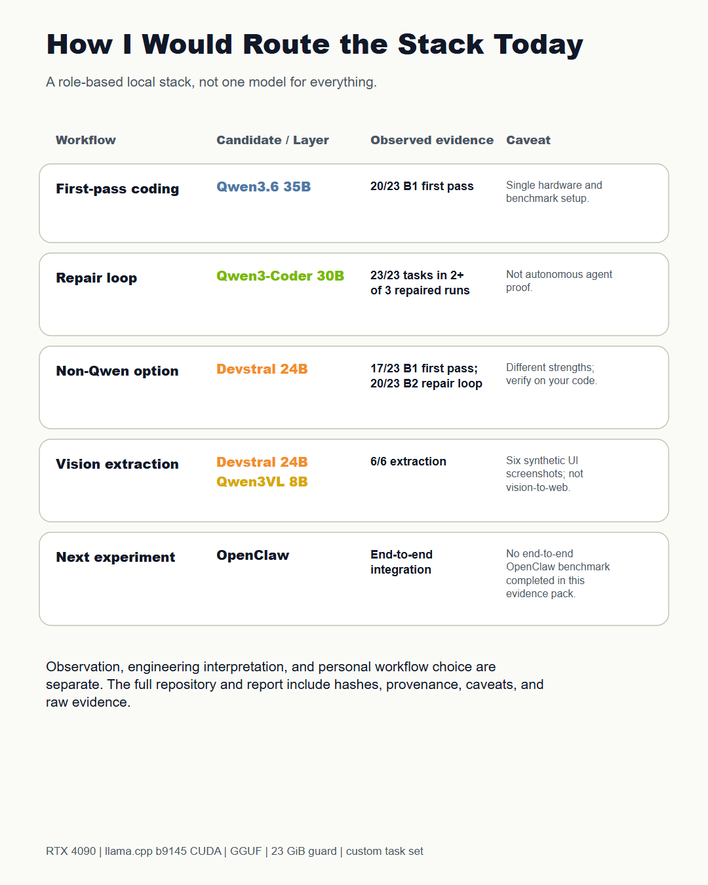
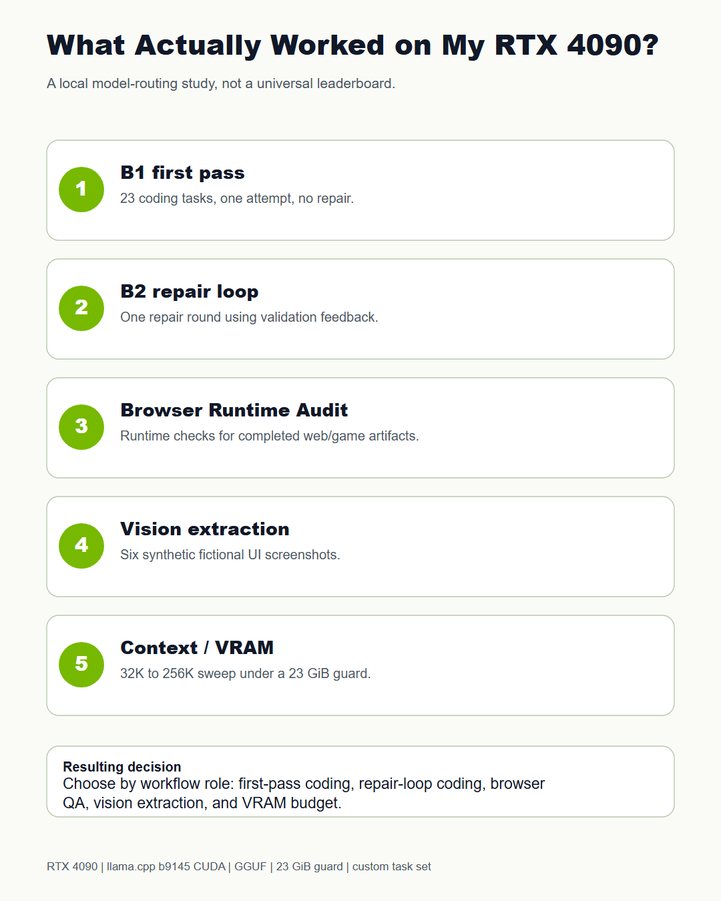
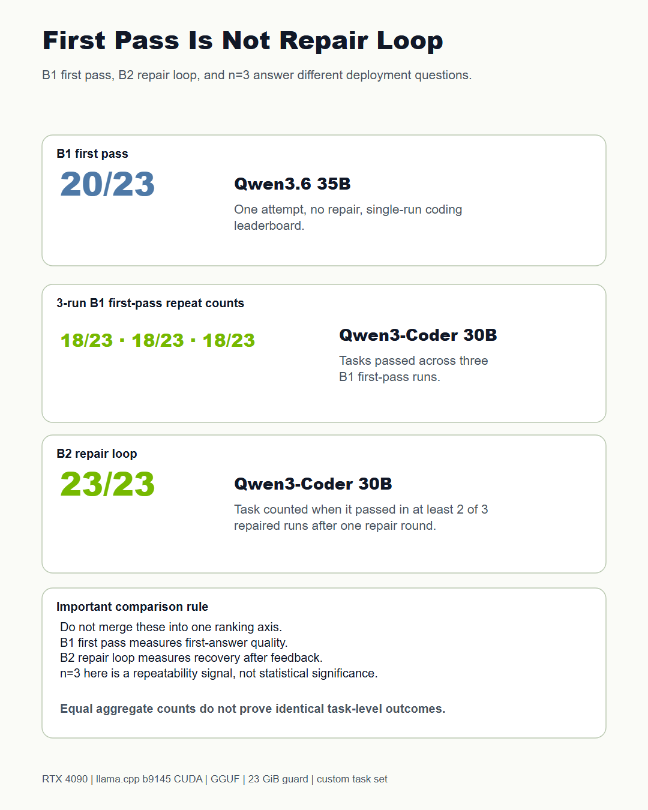
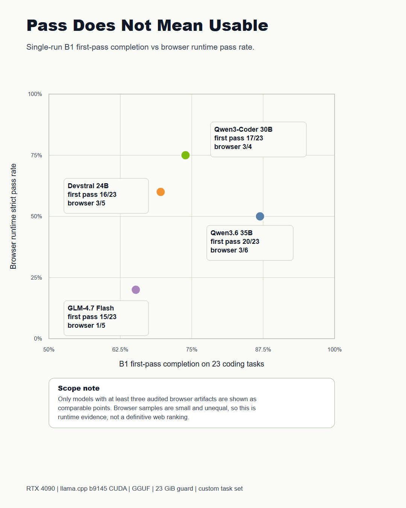
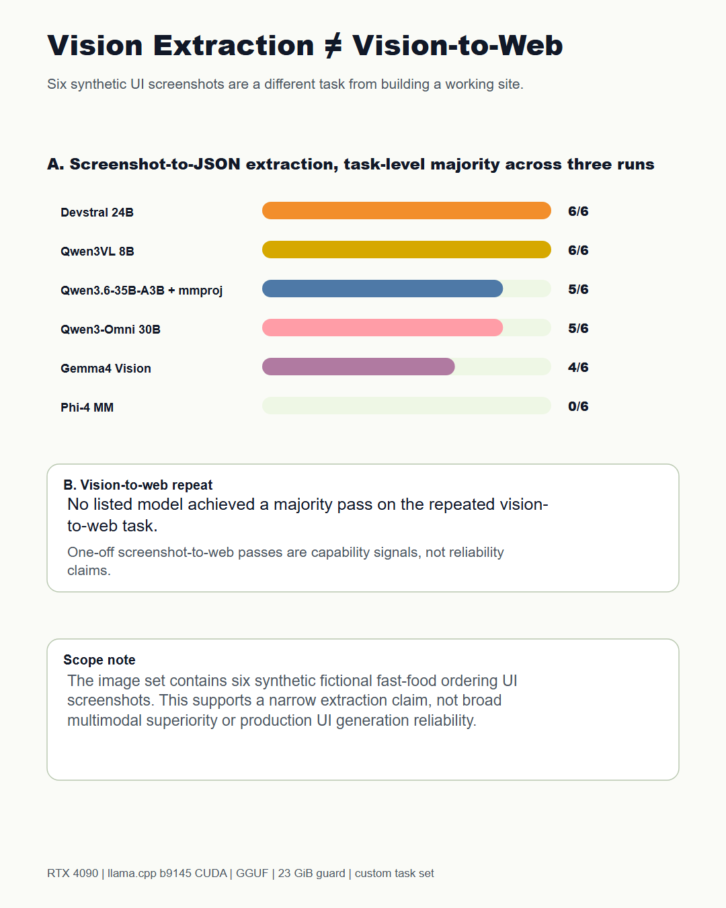
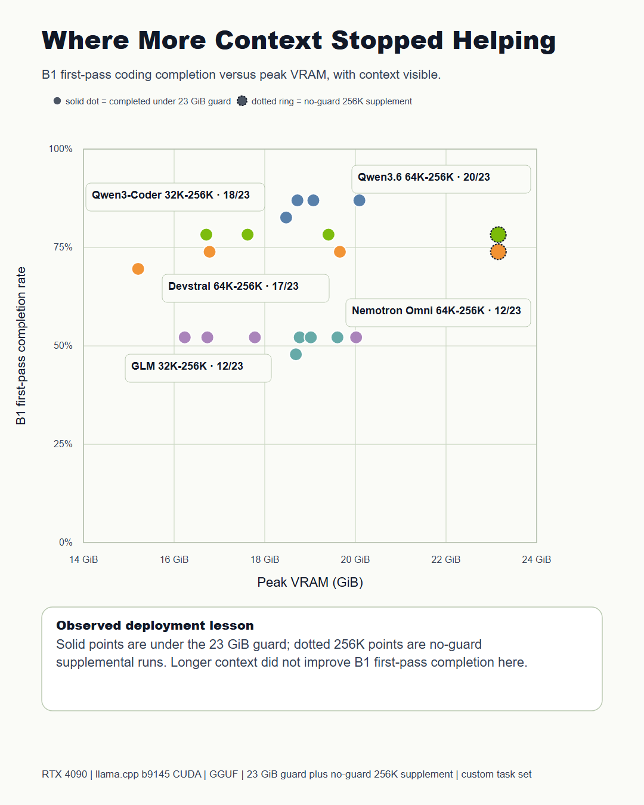

# RTX 4090 Local LLM Workflow Benchmark

A practical local workflow study for coding, repair loops, browser runtime validation, vision extraction, and context and VRAM limits.

Author: Howard Liu (Chuan-Hao Liu)

Repository name: `rtx4090-local-llm-workflow-benchmark`

This repository is a curated public release package for a single-workstation benchmark project. It is not a universal public leaderboard and it is not a dump of every local run artifact.

> **Follow-up study (October 2026):** [rtx4090-local-vs-cloud-coding-benchmark](https://github.com/Howard159357/rtx4090-local-vs-cloud-coding-benchmark)
> runs 16 local models and 6 cloud settings through 8 coding tasks designed by Claude Opus 5.5, three times each,
> with error analysis, a second inference engine, 256K long-context and multi-user tests.

## Why This Exists

The goal was to understand what actually works when building a local AI engineering stack on one RTX 4090 workstation. The study evaluates local GGUF models as solvers through a llama.cpp based local harness across coding tasks, repair-loop tasks, browser-openable web/game artifacts, vision extraction, and context and VRAM scaling.

The practical question is model routing: which local model or workflow layer is useful for local coding and future OpenClaw-style experiments under this hardware setup?

## What This Is Not

- Not a cross-hardware standard benchmark.
- Not a claim that one model is best overall.
- Not a deployment certification.
- Not an end-to-end OpenClaw benchmark.
- Not a comparison where ChatGPT is a scored local competitor.
- Not evidence that local models replace cloud AI in every workflow.

ChatGPT was used to help design tasks and rubrics. It was not scored as a local solver or used as the judge in this evidence pack.

This is a personal independent engineering project, not an official company publication.

## Hardware And Runtime Scope

- GPU class: RTX 4090 workstation.
- Runtime: local llama.cpp-based GGUF workflow.
- VRAM guard: 23 GiB for comparable runs unless marked as no-guard supplemental.
- Models: local GGUF models only; model weights are not included.
- Tasks: custom synthetic tasks created for this benchmark.

Context length is treated as an engineering budget, not a badge.

## Evaluation Layers

- **B1 first pass:** one first-pass attempt, no repair.
- **B2 repair loop:** one repair round using validation feedback.
- **n=3 repeatability:** practical repeatability evidence, not statistical significance.
- **Browser Runtime Audit:** runtime QA for completed browser-openable web/game artifacts.
- **Vision extraction:** screenshot-to-structured-data tasks.
- **Screenshot-to-web:** a separate vision-to-web capability from vision extraction.

## Key Findings

- First-pass coding and repair-loop coding reward different behavior.
- Browser-openable artifacts need runtime checks after task validation.
- Vision extraction and screenshot-to-web generation should not be merged into one score.
- Longer context did not monotonically improve B1 first-pass completion in this setup.
- No-guard 256K supplemental runs should be read separately from 23 GiB guarded runs.

### First pass versus repair loop

### Passing a validator is not the same as being usable

### Vision extraction versus screenshot-to-web

### Where more context stopped helping

## Model Routing Summary

The public charts summarize observed routing choices under this setup:

- First-pass coding: Qwen3.6 35B was strongest in the tested B1 setup.
- Repair loop: Qwen3-Coder 30B was strongest after one repair round.
- Non-Qwen option: Devstral 24B showed useful coding and repair behavior.
- Vision extraction: Devstral 24B and Qwen3VL 8B reached 6/6 on the six synthetic screenshot extraction tasks.
- Future experiment: end-to-end OpenClaw-style integration is not completed in this evidence pack.

These are engineering recommendations under one hardware and task setup, not universal truths.

## How To Read The Charts

The six charts are embedded above; PNG and SVG versions are in [docs/assets/charts](docs/assets/charts/).

| Chart | What it shows |
|---|---|
| [01 Workflow layers](docs/assets/charts/01_experiment_map_nvidia_accent_final.png) | The five evaluation layers of the study |
| [02 Coding vs browser](docs/assets/charts/02_coding_vs_browser_nvidia_accent_final.png) | Task pass separated from browser runtime usability |
| [03 First pass vs repair](docs/assets/charts/03_first_pass_repair_repeatability_nvidia_accent_final.png) | First-pass coding separated from repair-loop behavior, with n=3 repeatability |
| [04 Completion vs VRAM](docs/assets/charts/04_completion_vs_vram_nvidia_accent_final.png) | B1 completion versus peak VRAM and context |
| [05 Vision extraction vs generation](docs/assets/charts/05_vision_extraction_vs_generation_nvidia_accent_final.png) | Vision extraction separated from screenshot-to-web generation |
| [06 Routing decisions](docs/assets/charts/06_role_based_decision_matrix_nvidia_accent_final.png) | Practical role-based routing decisions |

This release supports the finalized three-post LinkedIn campaign:

- Post 1, "Can One RTX 4090 Support a Practical Local AI Workflow?": Charts 01 and 03.
- Post 2, "Pass Does Not Mean Usable": Charts 02 and 05.
- Post 3, "How I Would Route My Local AI Stack Today": Charts 06 and 04.

## Evidence Index

Start with:

- [Executive summary](docs/executive_summary.md)
- [Methodology](docs/methodology.md)
- [Validation ledger](docs/validation_ledger.md)
- [Task catalog](docs/task_catalog.md)
- [Context and VRAM attempt matrix](docs/context_vram_attempt_matrix.md)
- [Reproducibility notes](docs/reproducibility.md)

Processed CSV files are in [data/processed](data/processed/). A browsable version of this release is on
[GitHub Pages](https://howard159357.github.io/rtx4090-local-llm-workflow-benchmark/).

## Reproducibility Notes

This package includes processed data, public documentation, chart assets, and reproduction notes. It does not include model weights, local caches, raw temporary logs, or complete model outputs for every run.

See [docs/reproducibility.md](docs/reproducibility.md).

## Limitations

This is one workstation, one task set, one harness, and one practical evaluation protocol. Results can change with model quantization, runtime settings, prompts, validators, GPU memory policy, and repair strategy.

See [docs/limitations.md](docs/limitations.md).

## License

Code and scripts in this repository are licensed under the MIT License.

Documentation, charts, processed benchmark summaries, task catalog, validation
ledger, report materials, public figures, and processed CSV summaries are
licensed under the Creative Commons Attribution 4.0 International License,
CC BY 4.0, unless otherwise noted.

Model weights are not included in this repository. Third-party models remain
governed by their original providers' licenses and terms. See
`THIRD_PARTY_MODELS.md`.

Suggested attribution for charts, data summaries, and report materials:

Howard Liu (Chuan-Hao Liu), "RTX 4090 Local LLM Workflow Benchmark", 2026.
